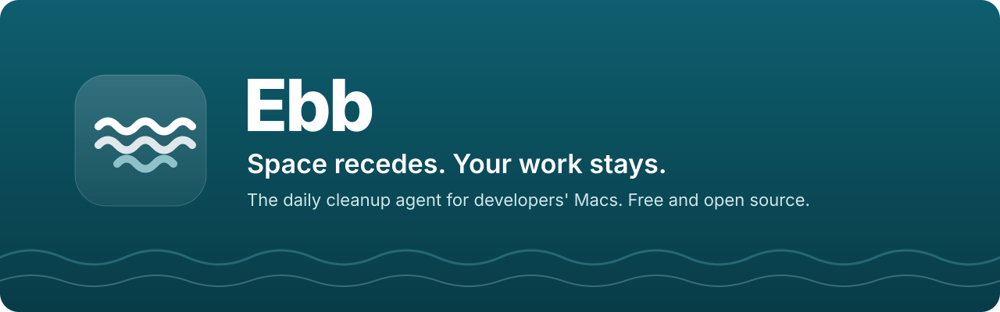
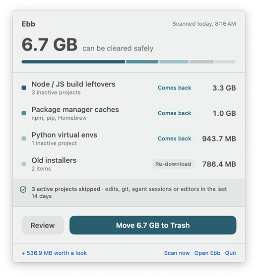
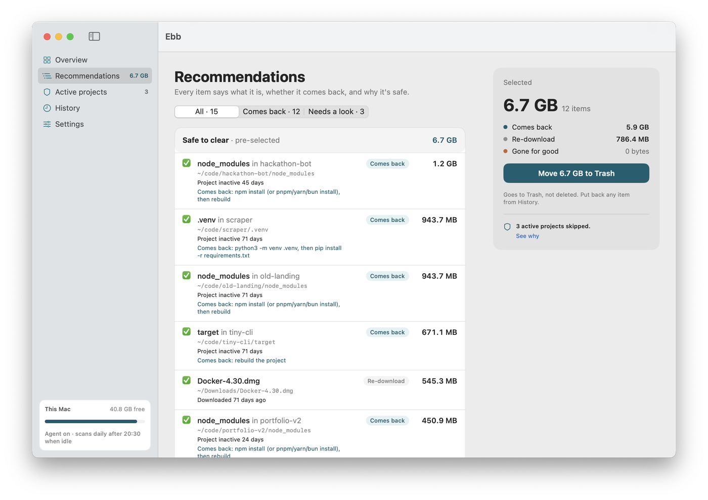
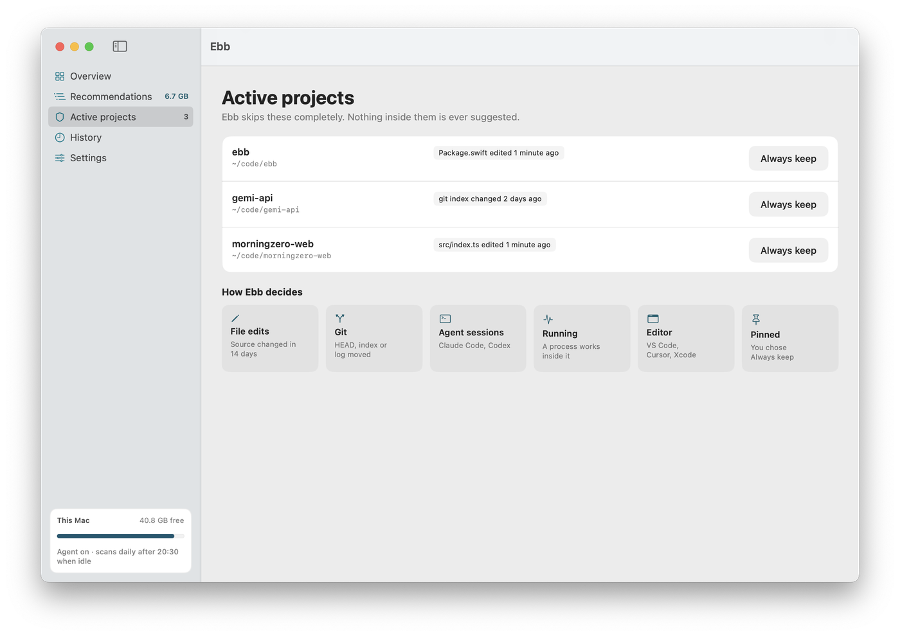
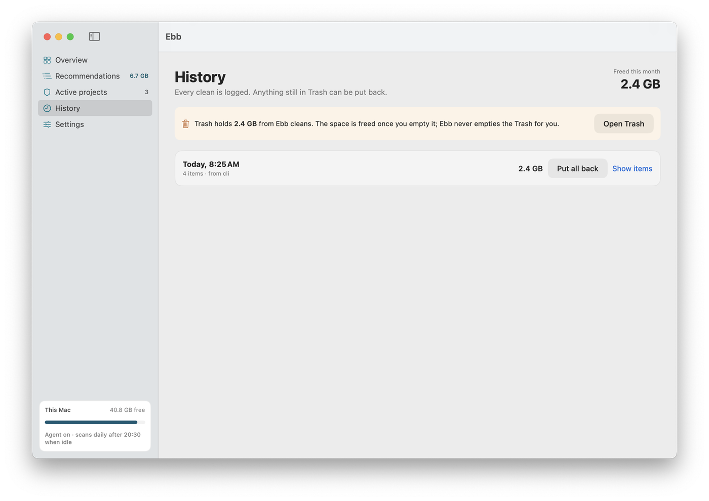
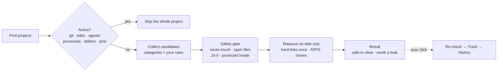

<p align="center">
  <a href="https://ebb.serveka.com"></a>
</p>

<p align="center">
  <a href="https://github.com/rajpra808/ebb/actions/workflows/ci.yml"></a>
  <a href="https://github.com/rajpra808/ebb/releases/latest"></a>
  
  
  <a href="LICENSE"></a>
</p>

<p align="center">
  <b>Your Mac's daily cleanup agent. It knows what you're working on and only suggests what's safe.</b><br>
  Old <code>node_modules</code>, virtual envs, build output, package caches, Xcode and Docker leftovers, AI agent history.<br>
  Free and open source. No account. Nothing leaves your Mac.
</p>

<p align="center">
  <a href="https://ebb.serveka.com"><b>Website</b></a> ·
  <a href="#install"><b>Install</b></a> ·
  <a href="#how-ebb-decides-what-youre-working-on"><b>How it decides</b></a> ·
  <a href="#safety-promises"><b>Safety</b></a> ·
  <a href="docs/ARCHITECTURE.md"><b>Architecture</b></a>
</p>

<br>

<table>
<tr>
<td width="58%"></td>
<td width="42%" align="center"></td>
</tr>
<tr>
<td><sub>A real <code>ebb scan</code> on the author's Mac: 16.0 GB that comes back on its own, with 35 projects in active use left completely alone.</sub></td>
<td align="center"><sub>The menu bar, once a day. Nothing moves until you click.</sub></td>
</tr>
</table>

## Install

```sh
curl -fsSL https://ebb.serveka.com/install.sh | sh
```

That downloads the latest [release](https://github.com/rajpra808/ebb/releases/latest), checks its SHA-256,
puts **Ebb.app** in Applications and links the `ebbctl` command (and `ebb`, unless something else owns that name).
It's [a short script](landing/install.sh); read it first if you like.

> [!NOTE]
> Ebb isn't notarized by Apple yet. Downloads with `curl` aren't flagged by macOS, so the app opens normally.
> If you download `Ebb.zip` in a browser instead, right-click **Ebb.app** and choose **Open** the first time.

Requires macOS 14 or later, on Apple silicon or Intel. To remove it:
`curl -fsSL https://ebb.serveka.com/install.sh | sh -s -- --uninstall` (add `--purge` to drop settings and history).

## Why

Package managers, build tools, local models and AI agents quietly eat 20 to 100 GB on a developer's Mac.
General cleaners don't know developer folders, and one scary "Clean" button isn't something you want anywhere near your code.

|  | Ebb |
|---|---|
| **Runs by itself** | A daily agent scans when the Mac is idle and sends one notification, only when at least 2 GB can go. |
| **Knows your active work** | Git, edits, Claude Code and Codex sessions, running dev servers and editor recents keep a project off limits. |
| **Explains every item** | What it is, its size on disk, whether it comes back, and why it's safe. |
| **Undoable** | Cleaning moves to the Trash and is logged. Put back one item or a whole clean. |
| **AI-era aware** | Old agent chats, unused local models and Cursor workspace storage, never pre-selected. |

Tools like [npkill](https://github.com/voidcosmos/npkill) and [kondo](https://github.com/tbillington/kondo) are great at finding build
folders when you ask, and [DevCleaner](https://github.com/vashpan/xcode-dev-cleaner) is great at Xcode. Ebb is the one you don't have to
remember, and it skips the projects you're in the middle of.

## See it

<table>
<tr><td colspan="2"></td></tr>
<tr>
<td width="50%"></td>
<td width="50%"></td>
</tr>
<tr>
<td><sub><b>Active projects.</b> Exactly why each project is protected, and "Always keep" to pin one.</sub></td>
<td><sub><b>History.</b> Every clean, what's still in the Trash, and Put back.</sub></td>
</tr>
</table>

<sub>Screenshots use a demo home folder.</sub>

## How Ebb decides what you're working on

A project is any folder with a marker (`.git`, `package.json`, `pyproject.toml`, `Cargo.toml`, `Package.swift`, `go.mod`,
`*.xcodeproj`...). If **any** of these is true in the last 14 days (7 or 30 if you prefer), the whole project is skipped:

| Signal | What Ebb looks at |
|---|---|
| ✎ **File edits** | A source file changed, outside `node_modules`, `dist` and other build folders |
| ⑂ **Git** | `.git/HEAD`, `index` or `logs/HEAD` moved: a commit, checkout, stage or pull |
| `›_` **Agent sessions** | A Claude Code session for the folder, or a Codex session whose `cwd` is inside it |
| ∿ **Running** | A shell, dev server, `node`, `python` or `claude` has its working folder inside it right now |
| ▢ **Editor** | Opened in VS Code, Cursor, Windsurf or Xcode |
| ⌖ **Pinned** | You chose "Always keep" |

`ebbctl active` lists every active project and the signals behind it.

## What it can clear

| Category | Examples | Comes back | Rule | Pre-selected |
|---|---|:---:|---|:---:|
| Node / JS leftovers | `node_modules`, `.next`, `.turbo`, `dist`, `build` | ✅ reinstall | Project inactive | ✓ |
| Python virtual envs | `.venv`, `venv` with `pyvenv.cfg` | ✅ `pip install` | Project inactive | ✓ |
| Other build output | Rust `target`, Swift `.build`, Gradle | ✅ rebuild | Project inactive | ✓ |
| Package caches | npm, pnpm, Yarn, Bun, pip, Homebrew, CocoaPods, Go | ✅ refills | Always eligible | ✓ |
| Xcode | DerivedData, old device support, dead simulators | ✅ rebuild | Project inactive or gone | ✓ |
| Docker | Untagged images, unused build cache | ✅ rebuild | Not used by any container | ✓ |
| Temp files | `$TMPDIR` (and `~/Library/Caches` if you opt in) | ✅ apps recreate | 3 days untouched, not open | ✓ |
| Old installers | `.dmg`, `.pkg`, downloaded `.zip` in Downloads | ⬇️ re-download | Older than 30 days | ✓ |
| AI agent history | Claude Code, Codex, Gemini CLI, Cursor | ⛔ gone | Older than 30 days | |
| Local AI models | Ollama, LM Studio, Hugging Face | ⬇️ re-download | Not loaded in 30 days | |
| Xcode archives | `.xcarchive` | ⛔ gone | Older than 90 days | |
| Duplicates | Identical files in Downloads, Desktop, Documents | ⛔ gone | Same SHA-256, oldest kept | |

Things that can't come back are listed under "worth a look" and never pre-selected.
[docs/CATEGORIES.md](docs/CATEGORIES.md) has the details of each one.

## Safety promises

> [!IMPORTANT]
> These hold for every line of code, and a never-touch test suite checks them before every release.

1. **Nothing happens on its own.** Scans are read-only. Cleaning needs your click, only moves to the Trash, and every move is
   logged so it can be put back. Ebb never deletes and never empties the Trash.
2. **Checked again before moving.** Right before an item moves, Ebb re-checks open files, recent changes and whether its project
   became active since the scan.
3. **A built-in never-touch list always wins**, even over your own rules: `.git`, `.env*`, `CLAUDE.md` and agent memory,
   `~/.claude/settings*.json`, `.credentials*`, `~/.codex/config*`, SSH and cloud credentials, keychains, `/System`, other users.
4. **Recent and open files stay.** Anything changed in the last 24 hours or open in an app is left out.
5. **Symlinks are never followed**, and other disks are skipped unless you ask.
6. **When unsure, it leaves it.** A `build` folder git tracks, an unreadable folder, a `.zip` you made yourself: all skipped.
7. **Tools clean their own caches.** For the pnpm store, Docker and Go modules, Ebb shows the command (`pnpm store prune`...) and
   leaves running it to you.

## How a scan works



The scanner is a read-only Swift library (`ScanCore`); moving to the Trash lives in a separate module (`EbbClean`).
[docs/ARCHITECTURE.md](docs/ARCHITECTURE.md) walks through each step and the JSON format.

## The command line

```sh
ebbctl scan                    # what's safe to clear (read-only)
ebbctl scan --details          # every item with its reason, and everything skipped
ebbctl scan --json             # the full result for scripts
ebbctl active                  # active projects and why
ebbctl clean --dry-run         # what would go to the Trash
ebbctl clean                   # move the pre-selected items, after asking
ebbctl history                 # every clean, and what's still in the Trash
ebbctl undo                    # put the last clean back
ebbctl rule add '\.mov$' --in ~/Movies --older 90d --larger 500MB --name "Old recordings"
```

`ebb` is the same tool. MacTeX also ships a command called `ebb`; if yours comes first on the PATH, use `ebbctl`.

<details>
<summary><b>Custom rules</b></summary>
<br>

Add your own patterns. `suggest` rules list matches under "worth a look" and are never pre-selected; `--never-touch` rules
protect matches from everything else.

```sh
ebbctl rule add '^Screen Recording .*\.mov$' --in ~/Desktop --older 14d --name "Old screen recordings"
ebbctl rule add '^client-' --in ~/code --never-touch
ebbctl rule list
```

Rules live in `~/Library/Application Support/Ebb/rules.json`. Invalid patterns are refused, and matching is time-boxed so a bad
pattern can't hang a scan. See [docs/RULES.md](docs/RULES.md).
</details>

## Questions

<details>
<summary><b>Why does it need Full Disk Access?</b></summary>
<br>
macOS hides parts of <code>~/Library</code> and some tool folders from apps without it. Without access Ebb still works, but it can't
see or vouch for those folders, so it skips them. The first-run screen walks you through it.
</details>

<details>
<summary><b>Why not the App Store?</b></summary>
<br>
Full Disk Access and moving files to the Trash across the disk don't fit the App Store sandbox.
</details>

<details>
<summary><b>Does it send anything anywhere?</b></summary>
<br>
No. No account, no analytics, no network calls. The only processes it starts are <code>lsof</code>, <code>git ls-files</code>, and, if
installed, <code>docker system df</code> and <code>xcrun simctl list</code>, all read-only.
</details>

<details>
<summary><b>How big is the difference between "size" and what I get back?</b></summary>
<br>
Ebb reports what clearing frees: allocated blocks, with hard-linked data counted once and blocks shared with APFS clones left out.
pnpm, for example, shares files between projects, so those sizes are marked <code>~</code> (estimated).
</details>

<details>
<summary><b>Does it run on Linux?</b></summary>
<br>
The CLI builds and its tests pass on Linux, with fewer features. The app and the daily agent are macOS only.
See <a href="cli/linux/README.md">cli/linux</a>.
</details>

## Build from source

```sh
git clone https://github.com/rajpra808/ebb && cd ebb
swift build -c release && .build/release/ebb scan      # the CLI
./app/scripts/bundle.sh && open app/build/Ebb.app      # the app
./scripts/test.sh                                      # tests (or `swift test` with Xcode)
```

```
Sources/ScanCore/    the scanner: categories, projects, signals, measuring, rules, safety (read-only)
Sources/EbbClean/    move to Trash, the clean log, put back
Sources/EbbCLI/      the ebbctl commands
app/                 the menu bar app (SwiftUI), its own Swift package
landing/             ebb.serveka.com and install.sh
docs/                spec, architecture, categories, rules
```

## Contributing

Categories are data: most new ones are a single entry in
[`categories.json`](Sources/ScanCore/Categories/categories.json) plus a fixture test.
[CONTRIBUTING.md](CONTRIBUTING.md) explains what a pull request needs. Ideas and bug reports are very welcome in
[Issues](https://github.com/rajpra808/ebb/issues).

## License

[MIT](LICENSE). Made by [Rajendra Prajapat](https://github.com/rajpra808) at Serveka.
